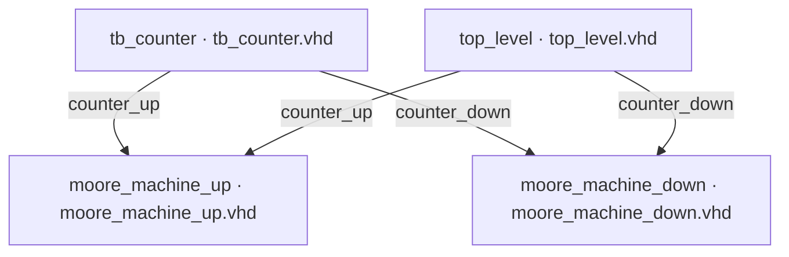

# Codemap: state-machine-counter

← [README](README.md)

> Generated from commit `4a6e5ae` by `scripts/codemap.py`. Regenerate it from the workspace root with `python3 scripts/codemap.py state-machine-counter`; don't edit it by hand.

## Design

### `moore_machine_down` (`moore_machine_down.vhd`)

- **In:** `i_clk`, `i_rst`, `i_go`
- **Out:** `o_led`
- **Generics:** `MAX_COUNT`

### `moore_machine_up` (`moore_machine_up.vhd`)

- **In:** `i_clk`, `i_rst`, `i_go`
- **Out:** `o_dn`, `o_led`
- **Generics:** `MAX_COUNT`

### `tb_counter` (`tb_counter.vhd`)

- **In:** -
- **Out:** -

### `top_level` (`top_level.vhd`)

- **In:** `sys_clk`, `btn_reset`, `btn_go`
- **Out:** `led_bank`
