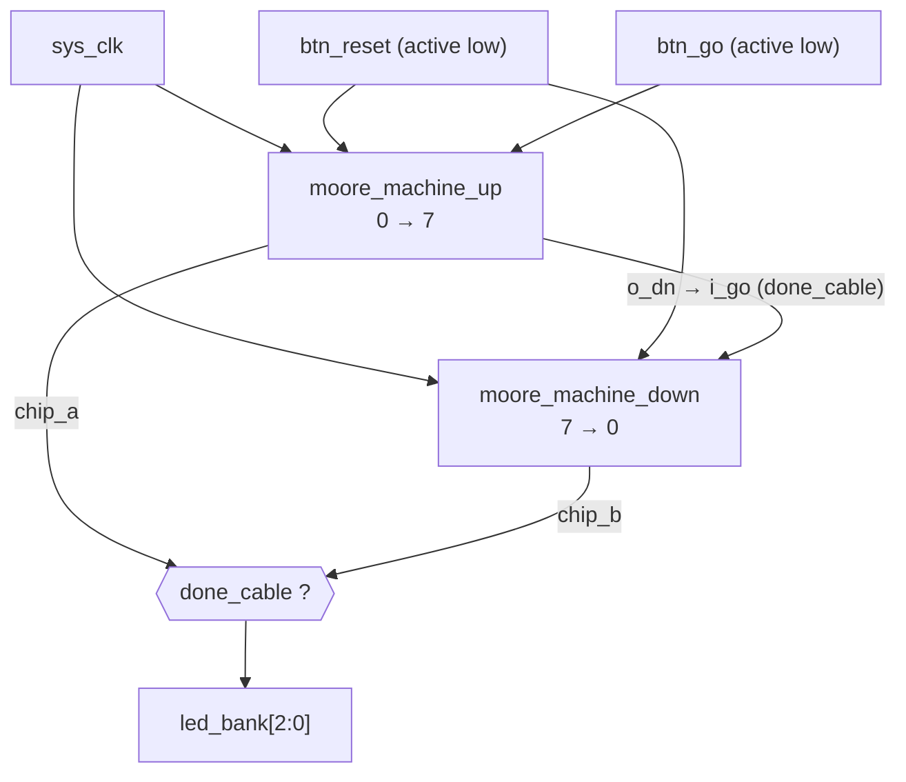
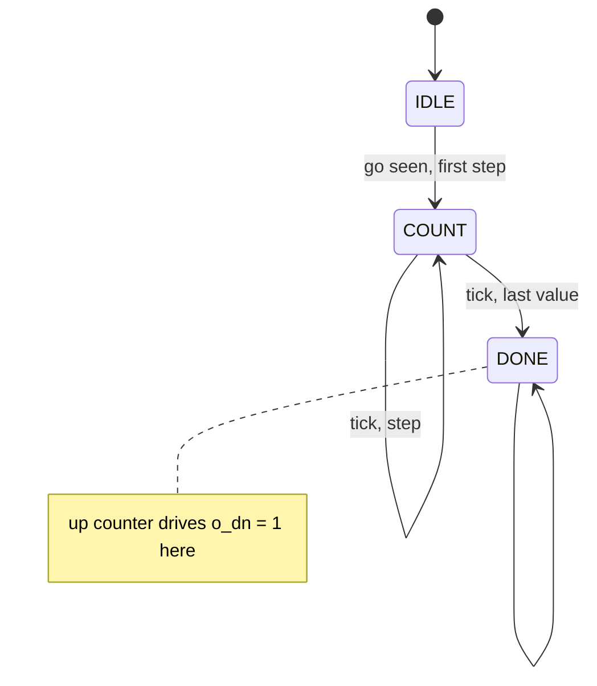

# Cascaded Moore Counter

> Two Moore machines on one 3-LED bank: one counts 0→7, then hands off to one that counts 7→0.


## Overview

`top_level.vhd` wires the up counter's `o_dn` into the down counter's `i_go`, and a mux follows the same wire. The down counter doesn't know it's second: the sequencing lives in the wiring. Targets the Cyclone II `EP2C5T144C8` (pins in `top_level.qsf`).

## Architecture



## State Machines

Both share one shape. A divider pulses `w_clk_tk` once per `MAX_COUNT` clocks (1 s at 50 MHz) and states only move on that tick.



| | `moore_machine_up` | `moore_machine_down` |
|---|---|---|
| Range | 0 → 7 | 7 → 0 |
| `i_go` | active low | active high (fed by `o_dn`) |
| `o_dn` | `'1'` while in `DONE` | — |

What the LEDs show, one value per second, with no value shown twice at the handoff:

```
tick : go  1  2  3  4  5  6  7  8  9 10 11 12 13
LEDs : 0   1  2  3  4  5  6  7  6  5  4  3  2  1  0
           └──── chip_a ─────┘ └──── chip_b ─────┘
```

## Details

- **Go is remembered.** `i_go` is watched on every clock while idle, so a press shorter than a tick still starts the count.
- **Moore output.** `o_dn` comes straight from the state register, so the handoff costs no extra tick.
- **Active-low LEDs.** `o_led <= not w_cntr`; the board lights an LED on a low.
- **`ieee.numeric_std`** throughout, the portable standard (Quartus, GHDL, Vivado).

## Build

```bash
# Quartus 13.0sp1 (the last with Cyclone II): open top_level.qsf, compile, program over USB-Blaster
# simulation: set MAX_COUNT to 4 in the generic map so the waveform is readable
ghdl -a --std=08 moore_machine_up.vhd moore_machine_down.vhd top_level.vhd <your_tb>.vhd
```

**Codemap:** [CODEMAP.md](CODEMAP.md), the entities, ports and processes, generated from the code.

---
*powered by logic, coffee, and many sleepless nights*
